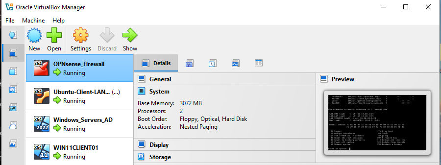
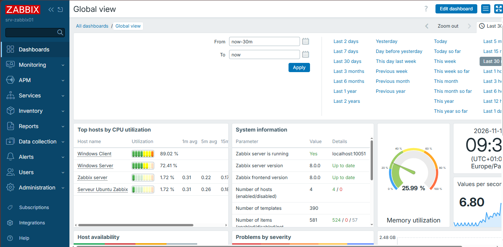
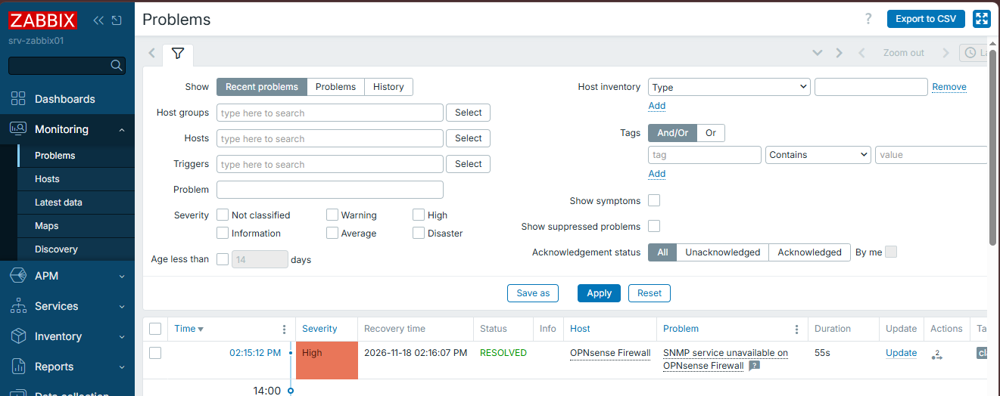
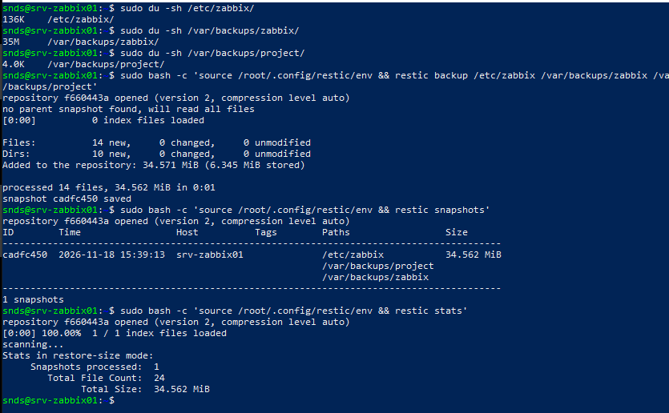
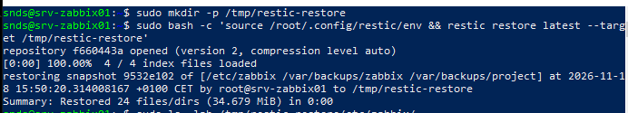
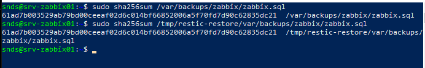

## Project Overview

This project is the second phase of a broader IT infrastructure project. It builds upon the infrastructure designed and deployed in [Project 1](Lab-Active-Directory-Opnsense), extending its capabilities through centralized monitoring, alert management, encrypted backups, data restoration procedures and Python-based automation.

While the first project focused on establishing the company's virtualized IT infrastructure, this second phase focuses on its operational monitoring, reliability, data protection and automation.

## Project Objectives

- Design a segmented virtual network using OPNsense.
- Deploy a Zabbix monitoring server.
- Monitor Linux and Windows machines using Zabbix agents.
- Monitor OPNsense through SNMPv3.
- Configure triggers to detect monitoring and availability issues.
- Simulate service failures and observe alert recovery.
- Implement encrypted backups using Restic.
- Automate backup execution and configure retention.
- Perform restoration tests and verify restored files using SHA-256.
- Develop Python scripts to monitor system resources and Restic snapshots.

## Lab Architecture

The infrastructure is composed of the following virtual machines and network components:

| Component | Role | IP address |
|---|---|---|
| OPNsense | Firewall and network segmentation | 10.10.10.1 |
| Ubuntu Server | Zabbix, Restic and Python automation | 10.10.10.10 |
| Windows 11 Client | Windows client monitoring | 10.10.10.20 |
| Windows Server | Active Directory lab server | 10.10.20.10 |

### Network segmentation

The OPNsense firewall provides three internal network interfaces:

| Network | Subnet | Gateway |
|---|---|---|
| LAB_LAN | 10.10.10.0/24 | 10.10.10.1 |
| LAB_SERVERS | 10.10.20.0/24 | 10.10.20.1 |
| LAB_DMZ | 10.10.30.0/24 | 10.10.30.1 |

The lab uses these segments to represent different areas of a small business network.

### Infrastructure overview



## Technologies Used

| Technology | Purpose |
|---|---|
| OPNsense | Firewall and network segmentation |
| Ubuntu Server | Linux server hosting the monitoring and backup services |
| Zabbix 8.0 | Infrastructure monitoring and alert management |
| Zabbix Agent 2 | Monitoring of Linux and Windows hosts |
| SNMPv3 | Secure monitoring of OPNsense |
| MariaDB | Zabbix database |
| Restic | Encrypted and deduplicated backups |
| Python 3 | Monitoring scripts and automation |
| psutil | System resource monitoring |
| Git and GitHub | Source control and project documentation |

## 1. Infrastructure Monitoring with Zabbix

Zabbix was deployed on the Ubuntu Server to centralize monitoring of the lab infrastructure.

Zabbix Agent 2 was installed on the monitored Windows and Linux systems. OPNsense was integrated using SNMPv3.

The monitoring covers, depending on the configured host and items:

- Host availability.
- CPU utilization.
- Memory utilization.
- Disk utilization.
- Network and SNMP availability.
- Collected monitoring data and host status.

### Monitoring dashboard


### Monitored hosts



## 2. Alerting and Failure Simulations

Triggers were configured in Zabbix to identify monitoring problems.

An availability trigger was created for OPNsense SNMP monitoring:

- Trigger name: `OPNsense SNMP unavailable`
- Event name: `SNMP service unavailable on {HOST.NAME}`
- Severity: High
- Detection expression:

```text
nodata(/OPNsense.internal/system.net.uptime[sysUpTime.0],5m)=1
```

This expression detects when Zabbix stops receiving the selected SNMP uptime data for five minutes.

A controlled failure simulation was performed by temporarily disabling the SNMP service on OPNsense. Zabbix detected the loss of data, raised a problem event and recovered after the service was enabled again.

Email notification settings were also configured. Their end-to-end delivery should be considered validated only when a successful notification is confirmed in the action log and recipient mailbox.

### Failure detection and recovery



## 3. Encrypted Backups with Restic

Restic was installed on the Ubuntu Server to implement encrypted backups.

The repository was initialized locally at:

```text
/srv/restic-repo
```

The Restic password and repository configuration are stored in a protected environment file outside the GitHub project.

The backup procedure includes:

1. Exporting the Zabbix MariaDB database.
2. Backing up the Zabbix configuration.
3. Backing up the selected project backup directory.
4. Storing the backup snapshots in the Restic repository.
5. Checking repository integrity.

The automated backup script is executed through a root cron job every day at 02:00.

### Retention policy

The configured retention policy is:

- 7 daily snapshots.
- 4 weekly snapshots.
- 6 monthly snapshots.

The policy is applied using Restic's `forget` and `prune` commands.

### Backup verification

Repository checks and snapshot listings were performed to verify the backup process.



## 4. Restoration Tests

A restoration test was performed to verify that the stored backup data could be recovered.

The procedure included:

1. Creating a temporary restoration directory.
2. Restoring the latest snapshot.
3. Checking the restored Zabbix configuration and database export.
4. Comparing the SHA-256 checksums of the original and restored SQL export.

Matching SHA-256 checksums confirm that the compared files are identical.

These tests demonstrate the recovery procedure for the selected backup data.

### Restoration evidence





## 5. Python Monitoring Scripts

Two Python scripts were developed to add lightweight monitoring capabilities to the lab.

### System resource monitoring

`system_monitor.py` uses the `psutil` library to collect:

- CPU utilization.
- RAM utilization.
- Disk utilization.

The script compares the collected values with configured thresholds:

| Resource | Alert threshold |
|---|---:|
| CPU | 80% |
| RAM | 85% |
| Disk | 85% |

It displays an OK status when the values remain below the thresholds and returns a warning with a non-zero exit code when a threshold is reached.

### Restic backup monitoring

`backup_monitor.py` checks whether the Restic repository can be accessed and whether snapshots are available.

It displays:

- The total number of snapshots.
- The latest snapshot identifier.
- The latest backup date.
- The hostname associated with the snapshot.

The script checks snapshot availability; repository integrity and restoration are verified separately using Restic commands.

### Dependencies

The Python dependency is listed in:

```text
scripts/python/requirements.txt
```

Install it in a Python virtual environment with:

```bash
python3 -m venv venv
source venv/bin/activate
python -m pip install -r requirements.txt
```

### Project scripts

- `scripts/python/system_monitor.py`
- `scripts/python/backup_monitor.py`

## Project Structure

```text
infrastructure-monitoring-lab/
├── README.md
├── .gitignore
├── documentation/
├── scripts/
│   └── python/
│       ├── system_monitor.py
│       ├── backup_monitor.py
│       └── requirements.txt
└── screenshots/
    ├── 01-architecture/
    ├── 02-zabbix-server/
    ├── 03-windows-server/
    ├── 04-windows-client/
    ├── 05-opnsense/
    ├── 06-alerts/
    ├── 07-restic-backups/
    └── 08-restoration-tests/
```

## Security Considerations

Sensitive information is deliberately excluded from the GitHub repository.

The following items must remain outside the repository:

- Restic passwords and environment files.
- System and service credentials.
- Private keys and certificates.
- Database exports and backup repositories.
- Files containing confidential information.

The `.gitignore` file helps prevent accidental inclusion of these files. It does not replace proper secret management or a review of the Git history before publication.

## Scope and Limitations

This project was implemented in a virtualized lab environment for learning and technical demonstration purposes.

The Restic repository is hosted locally on the Ubuntu Server. This validates the backup and restoration workflow, but it does not provide protection against the loss of the server or its storage device.

A production deployment should use an independent remote backup destination, access controls, monitoring of backup failures and regularly scheduled recovery tests.

## Conclusion

This lab brought together network segmentation, centralized monitoring, alert management, encrypted backup operations, restoration testing and Python automation.

It provided practical experience in deploying and administering infrastructure services, identifying availability issues, protecting selected data and verifying recovery procedures.

The project also emphasizes the importance of documenting technical configurations and maintaining evidence of the tests performed.

---

**Project type:** Practical infrastructure and system administration lab  
**Focus areas:** Network administration, monitoring, backup, recovery and automation
