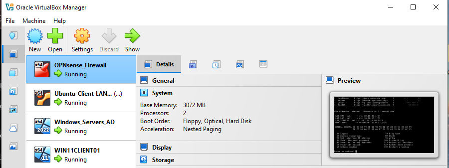

# 01 – Infrastructure Overview

## 1. Objective

This project is the second phase of the SME IT infrastructure project presented in [Project 1 – Lab Active Directory & OPNsense](https://github.com/SNDS-1/Lab-Active-Directory-Opnsense).

The objective of this phase is to extend the existing virtualized infrastructure with centralized monitoring, alert management, encrypted backups, restoration procedures and Python automation.

## 2. Infrastructure Components

The lab is based on the following virtual machines and network equipment:

| Component | Role | IP address |
|---|---|---|
| OPNsense | Firewall and network gateway | 10.10.10.1 |
| Ubuntu Server | Zabbix, Restic and Python | 10.10.10.10 |
| Windows 11 Client | Client workstation | 10.10.10.20 |
| Windows Server | Active Directory server | 10.10.20.10 |

## 3. Network Segmentation

The network is divided into three logical segments:

| Network | Subnet | Gateway |
|---|---|---|
| LAB_LAN | 10.10.10.0/24 | 10.10.10.1 |
| LAB_SERVERS | 10.10.20.0/24 | 10.10.20.1 |
| LAB_DMZ | 10.10.30.0/24 | 10.10.30.1 |

OPNsense manages the network interfaces and provides the firewall functionality.

## 4. Role in Project 2

This infrastructure serves as the foundation for the monitoring and backup solutions implemented in the following sections.

## 5. Evidence

The screenshot presents the virtual machines used in the lab.
