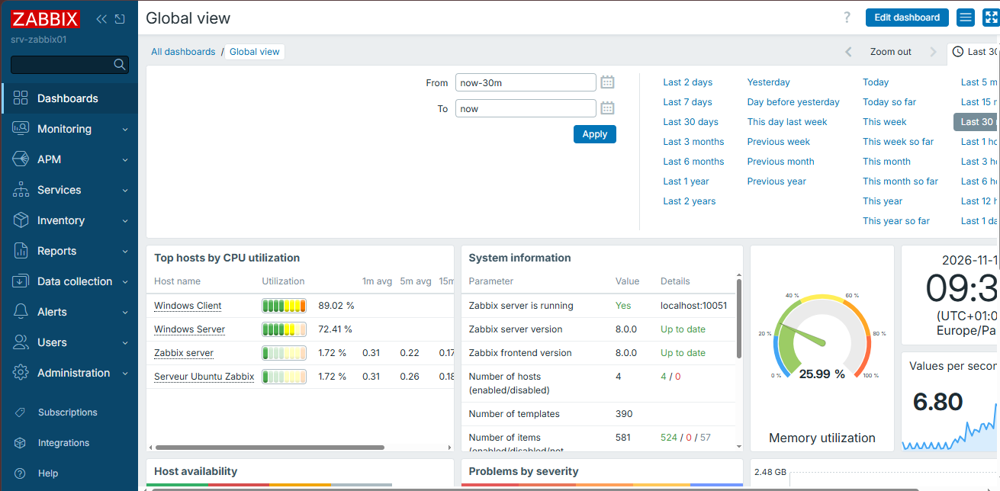
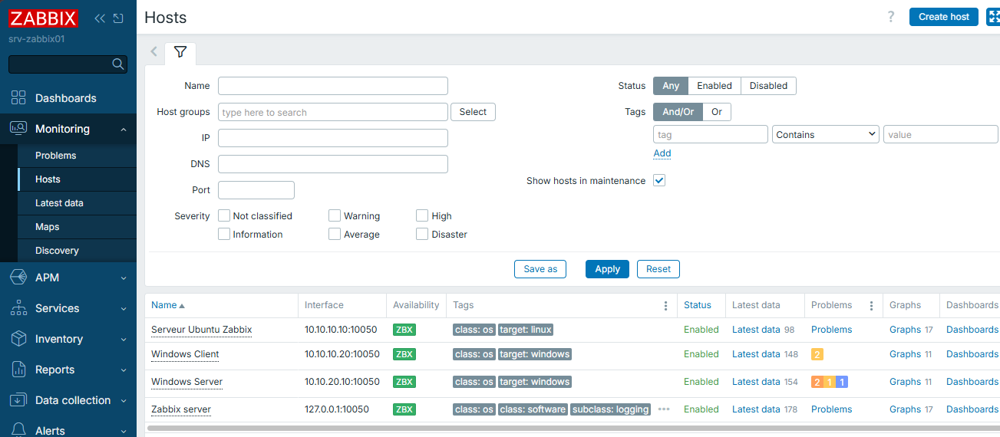

# 02 – Zabbix Infrastructure Monitoring

## 1. Objective

Zabbix was deployed on the Ubuntu Server to centralize the monitoring of the lab infrastructure.

The objective is to observe the availability and resource usage of the monitored systems through a centralized interface.

## 2. Configuration

The monitoring environment includes:

- Zabbix Server 8.0 hosted on Ubuntu Server.
- Zabbix Agent 2 on the monitored Linux and Windows systems.
- SNMPv3 integration for OPNsense.
- Host groups, monitored hosts and data collection items.

## 3. Monitored Systems

The monitored infrastructure includes the Ubuntu Server, Windows Server, Windows 11 Client and OPNsense firewall.

Depending on the configured items, monitoring data includes CPU, memory, disk usage and network availability.

## 4. Verification

The Zabbix dashboard and host list were used to verify that the monitored systems were correctly registered and that data was being collected.

## 5. Evidence

Additional resource monitoring evidence:

- [Windows Server CPU](../../screenshots/03-windows-server/CPU.png)
- [Windows Server Memory](../../screenshots/03-windows-server/Memory.png)
- [Windows Server Disk](../../screenshots/03-windows-server/Disk.png)
- [Windows Client CPU](../../screenshots/04-windows-client/CPU.png)
- [Windows Client Memory](../../screenshots/04-windows-client/Memory.png)
- [Windows Client Disk](../../screenshots/04-windows-client/Disk.png)

OPNsense monitoring:

- [Availability](../../screenshots/05-opnsense/Zabbix-OPNsense-Availability.png)
- [Latest data](../../screenshots/05-opnsense/Zabbix-OPNsense-LatestData.png)
