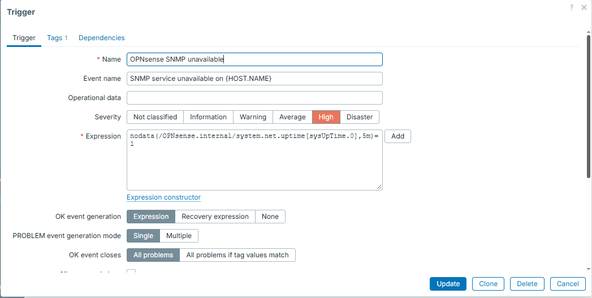
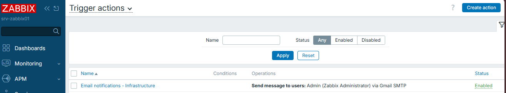
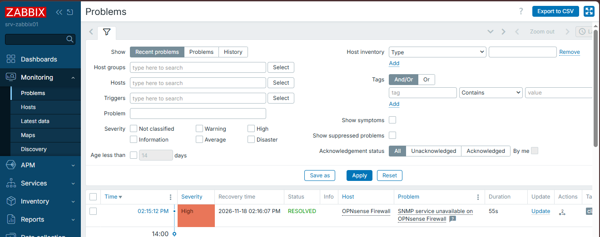

# 03 – Alerts and Failure Simulations

## 1. Objective

This section presents the alert configuration in Zabbix and a controlled failure simulation used to verify the detection and recovery process.

## 2. SNMP Availability Trigger

A trigger was configured for the OPNsense host to detect when SNMP monitoring data is no longer received.

| Parameter | Configuration |
|---|---|
| Host | OPNsense.internal |
| Trigger name | OPNsense SNMP unavailable |
| Event name | SNMP service unavailable on {HOST.NAME} |
| Severity | High |
| Detection period | 5 minutes |

Trigger expression:

```text
nodata(/OPNsense.internal/system.net.uptime[sysUpTime.0],5m)=1
```

## 3. Failure Simulation

The SNMP service on OPNsense was temporarily disabled to simulate a monitoring interruption.

Zabbix detected the absence of SNMP data and generated a problem event. After the service was re-enabled, monitoring data resumed and the problem returned to a recovered state.

## 4. Notification Configuration

Email notification settings and an alert action were configured in Zabbix. Successful end-to-end delivery must be confirmed separately through the action log and recipient mailbox.

## 5. Evidence







Additional evidence:

- [Email action log](../../screenshots/06-alerts/Email-action-log.png)
- [Email recipient configuration](../../screenshots/06-alerts/Email-Recipient.png)
