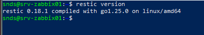
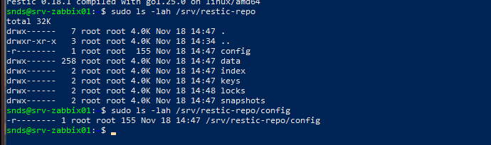
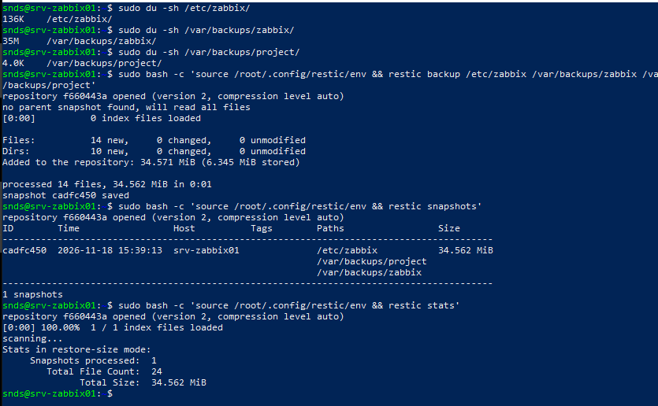
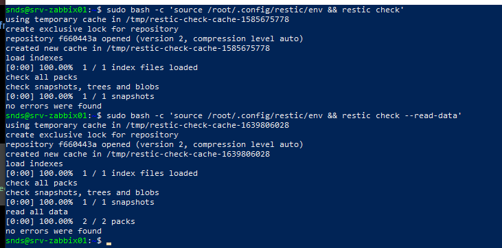
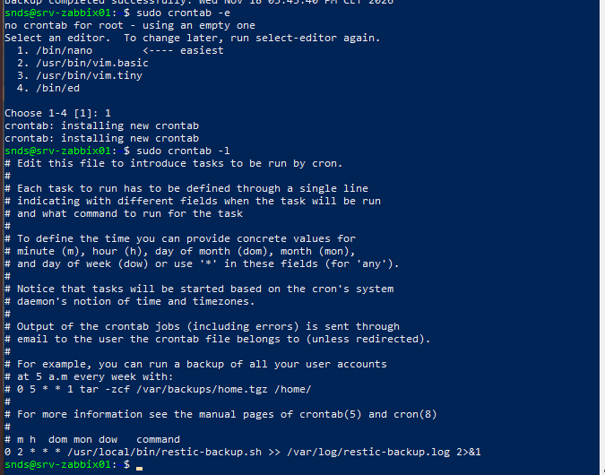
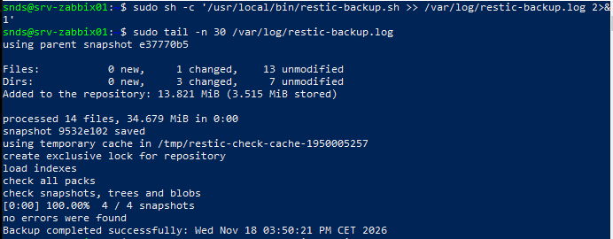
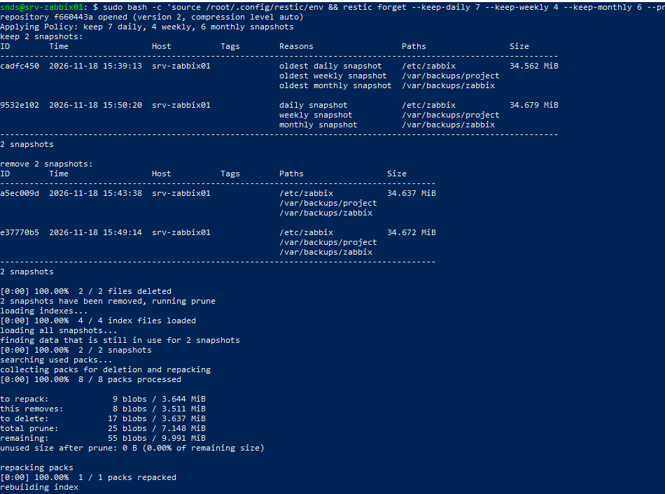

# 04 – Encrypted Backups with Restic

## 1. Objective

Restic was installed on the Ubuntu Server to implement an encrypted backup solution for selected Zabbix configuration and project data.

The objective is to automate backup execution and maintain snapshots that can be used for recovery.

## 2. Repository Configuration

The local Restic repository is located at:

```text
/srv/restic-repo
```

The repository password and configuration are stored in a protected environment file outside the GitHub project.

## 3. Backup Sources

The backup procedure includes:

- `/etc/zabbix`
- `/var/backups/zabbix`
- `/var/backups/project`

The Zabbix database is exported using `mariadb-dump` before the backup operation.

## 4. Automation

A shell script named `restic-backup.sh` automates the database export, backup execution and repository check.

A root cron job schedules the backup every day at 02:00.

## 5. Retention Policy

The configured retention policy is:

- 7 daily snapshots.
- 4 weekly snapshots.
- 6 monthly snapshots.

Restic `forget` and `prune` commands are used to apply the policy.

## 6. Verification

Snapshots are listed and repository integrity is checked using Restic commands.

## 7. Evidence















Additional evidence:

- [Zabbix database export](../../screenshots/07-restic-backups/01-zabbix-database-export.png)
- [Restic check](../../screenshots/07-restic-backups/Restic-Check.png)
- [Snapshots and integrity](../../screenshots/07-restic-backups/Restic-Snapshots-Integrity.png)
