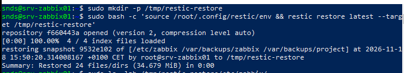
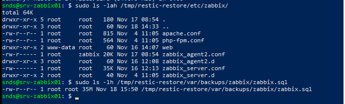
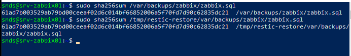

# 05 – Backup Restoration Tests

## 1. Objective

This section documents the restoration test performed with Restic to verify that selected backup data can be recovered.

## 2. Restoration Procedure

The test consisted of:

1. Creating a temporary restoration directory.
2. Restoring the latest available snapshot.
3. Checking the restored Zabbix configuration files.
4. Checking the restored Zabbix database export.
5. Comparing the original and restored SQL export using SHA-256.

## 3. Integrity Verification

The SHA-256 checksums were calculated for the original and restored SQL files.

Matching checksums indicate that the two compared files are identical.

This test validates the recovery of the selected files from the tested snapshot.

## 4. Evidence

## 5. Result

The restoration procedure and checksum comparison provide evidence that the selected backup data can be recovered and compared with the original files.
